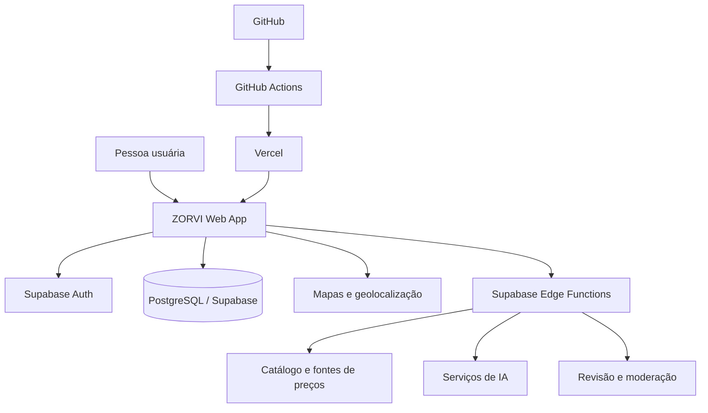

<div align="center">

# ZORVI

### Tudo se conecta. Tudo se descobre.

**Plataforma de descoberta local, comunidade e comparação de preços.**

[](https://github.com/1joao-dev/zorvi-startup)
[](https://react.dev/)
[](https://www.typescriptlang.org/)
[](https://supabase.com/)
[](https://vercel.com/)

[Aplicação](https://github.com/1joao-dev/zorvi-startup) · [Código-fonte](https://github.com/1joao-dev/zorvi-startup) · [Documentação](docs/)

</div>

---

## 1. Visão geral

A **ZORVI** é uma aplicação web mobile-first criada para aproximar pessoas, estabelecimentos e informações úteis da sua região. A proposta reúne descoberta local, mapa, catálogo de produtos, consulta e comparação de preços, recursos de inteligência artificial e interação comunitária em uma única experiência.

O projeto está em **fase beta**. O objetivo desta etapa é validar os principais fluxos, a qualidade das informações e a experiência de uso antes de uma expansão mais ampla.

### Problema que buscamos resolver

Encontrar um estabelecimento, localizar um produto e entender onde existe uma oferta relevante costuma exigir pesquisas em diferentes aplicativos, mapas e fontes. Além disso, preços sem origem, data ou contexto podem induzir a comparações incorretas.

### Proposta de valor

- Centralizar a descoberta de estabelecimentos e produtos locais.
- Facilitar a consulta de preços com origem, data e critérios de confiança.
- Ajudar o usuário a explorar opções por localização e categoria.
- Conectar descoberta local e participação da comunidade.
- Usar IA como apoio à pesquisa, sem substituir a verificação das informações.

## 2. Funcionalidades do produto

| Módulo | Objetivo | Situação no beta |
|---|---|---|
| Início e comunidade | Feed, criação de publicações e interação | Interface implementada; parte do conteúdo pode ser demonstrativa |
| Mapa | Explorar estabelecimentos e pontos de interesse | Implementado com geolocalização e filtros |
| Catálogo | Consultar produtos e informações de referência | Implementado com fontes e rotinas de importação |
| Comparação de preços | Consultar observações associadas a produtos e estabelecimentos | Implementado com regras de atualização e revisão |
| ZORVI AI | Consultar catálogo e apoiar a descoberta por linguagem natural | Integração implementada; depende da configuração dos serviços e limites de API |
| Perfil e autenticação | Identidade e acesso do usuário | Integração com Supabase Auth |
| Moderação de preços | Revisar observações antes de entrarem nas comparações | Painel e função de revisão implementados |
| Marketing HQ | Organizar tarefas, agentes e conhecimento supervisionado | Interface e backend em evolução; execução de IA depende da configuração da chave Gemini |

> **Transparência do beta:** a presença de um módulo na interface não significa que todas as integrações estejam habilitadas em produção. Dados demonstrativos são distintos de preços verificados. A ZORVI não presume estoque ou disponibilidade a partir de uma observação de preço.

## 3. Arquitetura e tecnologias

### Stack principal

| Camada | Tecnologias |
|---|---|
| Interface | React 19, TypeScript |
| Aplicação e rotas | TanStack Start, TanStack Router |
| Build e desenvolvimento | Vite |
| Estilização | Tailwind CSS v4 e CSS |
| Componentes e ícones | Radix UI, Lucide React |
| Dados e autenticação | Supabase, PostgreSQL, Supabase Auth |
| Backend serverless | Supabase Edge Functions (Deno) |
| Mapas | MapLibre GL / Leaflet, OpenStreetMap e OpenFreeMap |
| Hospedagem e deploy | Vercel |
| Versionamento e CI | GitHub, GitHub Actions |
| Catálogos externos | Open Food Facts, dados abertos da ANVISA e fontes de preços integradas |

### Visão simplificada da arquitetura



A interface acessa os serviços por meio das integrações previstas no projeto. Operações privilegiadas e segredos devem permanecer no servidor, nunca no código entregue ao navegador.

## 4. Organização do repositório

```text
zorvi-startup/
├── .github/
│   └── workflows/
│       └── ci.yml
├── docs/
│   └── marketing-hq/
├── public/
├── scripts/
├── src/
│   ├── components/
│   │   ├── marketing-hq/
│   │   └── ui/
│   ├── hooks/
│   ├── lib/
│   ├── routes/
│   ├── styles/
│   └── test/
├── supabase/
│   ├── functions/
│   ├── migrations/
│   └── schema.sql
├── .env.example
├── package.json
└── README.md
```

### Principais funções serverless

| Função | Responsabilidade |
|---|---|
| `zorvi-ai` | Endpoint de inteligência artificial e consultas assistidas |
| `catalog-import` | Importação de observações de preços |
| `retail-catalog-sync` | Sincronização de catálogos varejistas integrados |
| `osm-store-discovery` | Descoberta de estabelecimentos a partir de dados geográficos |
| `geocode-stores` | Associação e verificação de estabelecimentos |
| `price-review` | Aprovação e rejeição de observações de preços |
| `zorvi-admin-monitor` | Monitoramento administrativo |
| `marketing-hq` | Orquestração do fluxo interno de marketing e conhecimento supervisionado |

## 5. Dados, confiança e segurança

A comparação de preços só é útil quando o usuário consegue entender o contexto da informação. Por isso, o projeto considera:

- **Origem:** identificar a fonte e o estabelecimento associado.
- **Data:** considerar quando o preço foi observado e a janela de atualização.
- **Revisão:** separar observações pendentes das aprovadas.
- **Correspondência:** evitar comparar produtos, variantes ou unidades incompatíveis.
- **Disponibilidade:** não inferir estoque a partir de um preço.
- **Proteção:** aplicar autenticação, políticas de acesso (RLS) e operações privilegiadas no servidor.

### Fontes de dados

- **Open Food Facts:** metadados colaborativos de produtos; não é fonte de preço local nem de estoque.
- **ANVISA:** dados regulatórios de medicamentos; registro não comprova comercialização ou disponibilidade em uma loja.
- **Open Prices e catálogos integrados:** observações e ofertas sujeitas a critérios de correspondência, origem, atualização e revisão.

A cidade-piloto documentada para a coleta de preços é **Teresina, Piauí**. A expansão geográfica depende da validação da cobertura e da qualidade dos dados.

## 6. Executar localmente

### Pré-requisitos

- Node.js compatível com as dependências do projeto.
- npm.
- Projeto Supabase para habilitar autenticação e recursos conectados.

### Instalação

```bash
git clone https://github.com/1joao-dev/zorvi-startup.git
cd zorvi-startup
npm install
```

Crie um arquivo `.env.local` a partir do exemplo:

```bash
cp .env.example .env.local
```

Configure as variáveis públicas do Supabase:

```env
VITE_SUPABASE_URL=https://SEU-PROJETO.supabase.co
VITE_SUPABASE_ANON_KEY=SUA_CHAVE_PUBLICA_ANON_OU_PUBLISHABLE
```

Inicie o ambiente:

```bash
npm run dev
```

### Comandos de qualidade

```bash
npm run build
npm run lint
npm test
```

### Sincronização de catálogos

Os scripts de importação exigem credenciais administrativas do Supabase no terminal. Consulte os comentários e instruções dos scripts antes de executar. Nunca coloque uma chave `service_role` em variáveis `VITE_*`, no frontend ou no Git.

## 7. Variáveis e segredos

- `VITE_SUPABASE_URL`: URL pública do projeto Supabase.
- `VITE_SUPABASE_ANON_KEY`: chave pública anon/publishable.
- Chaves de provedores externos e credenciais administrativas: armazenar exclusivamente nos Secrets do ambiente servidor (Supabase Edge Functions/Vercel quando aplicável).

**Nunca versionar** `.env.local`, tokens, senhas, chaves privadas ou credenciais `service_role`. O arquivo `.env.example` contém apenas nomes e valores ilustrativos.

## 8. Equipe e responsabilidades

O desenvolvimento é organizado em cinco frentes, alinhadas às entregas técnicas e acadêmicas do projeto:

| Frente | Responsabilidade | Evidência no repositório |
|---|---|---|
| Engenharia de Software | Visão do produto, problema, público, prioridades, backlog e critérios de aceite | README, escopo e documentação do produto |
| Tech Lead | Arquitetura, stack, padrões, integração e revisão técnica | Estrutura da aplicação, arquitetura e decisões técnicas |
| Programador | Telas, navegação, mapa, busca, feed e chat | `src/routes/`, `src/components/`, `src/styles/` |
| DevOps | Ambiente, banco, funções serverless, deploy e operação segura | `supabase/`, `.github/workflows/` e configuração de deploy |
| QA e UX | Testes, protótipo, usabilidade, validação e revisão | `src/test/`, critérios de confiança e fluxos de revisão |

**Nomes dos integrantes:** ainda precisam ser associados às cinco frentes. Consulte [docs/EQUIPE.md](docs/EQUIPE.md) para preencher os nomes reais e registrar a contribuição individual sem atribuir trabalho incorretamente.

## 9. Qualidade e integração contínua

O workflow em `.github/workflows/ci.yml` executa, em eventos de push e pull request para `main`:

1. Checkout do repositório.
2. Instalação do Bun.
3. Instalação das dependências.
4. Testes automatizados.
5. Build de produção.
6. Verificação sintática dos scripts de importação.

A publicação é integrada à Vercel a partir do repositório. O status final de cada deploy deve ser conferido no painel da Vercel.

## 10. Roadmap do beta

- [x] Estrutura inicial da aplicação e navegação.
- [x] Integração com Supabase e autenticação.
- [x] Mapa, descoberta e filtros.
- [x] Catálogo e funções de importação.
- [x] Fluxo de revisão de preços.
- [x] Pipeline de build e testes no GitHub Actions.
- [ ] Ampliar testes ponta a ponta com usuários.
- [ ] Concluir configuração e validação da API Gemini no Marketing HQ.
- [ ] Consolidar persistência e moderação das interações comunitárias.
- [ ] Medir cobertura, atualização e precisão das informações por região.
- [ ] Validar proposta de valor e modelo de negócio com usuários e estabelecimentos.

## 11. Contribuição

1. Crie uma branch para sua alteração.
2. Faça mudanças pequenas e documentadas.
3. Execute testes e build localmente.
4. Abra um Pull Request descrevendo objetivo, arquivos alterados e evidências.
5. Aguarde revisão antes de integrar à `main`.

Padrão sugerido de commits: `feat:`, `fix:`, `docs:`, `test:`, `refactor:` e `chore:`.

## 12. Licença e uso

Este repositório ainda não declara uma licença open source. Até que uma licença seja definida pelos responsáveis, não presuma autorização para redistribuir ou reutilizar o código. Dados e serviços de terceiros permanecem sujeitos às respectivas licenças e termos.

---

<div align="center">

**ZORVI — Tudo se conecta. Tudo se descobre.**

*Versão beta • Projeto em evolução*

</div>
